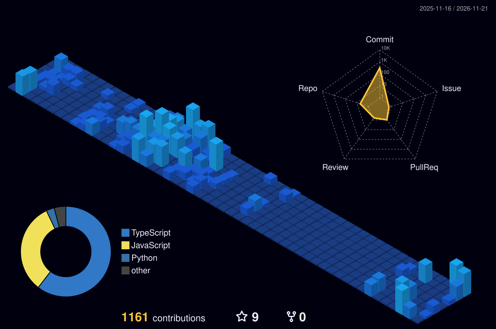

# Merhaba, ben Atakan Çalışkan

**Yazılım Mühendisi ve Yapay Zekâ Geliştiricisi** · İzmir, Türkiye

Bilgisayarlı görü, makine öğrenmesi ve ölçeklenebilir web uygulamaları geliştiriyorum. Dokuz Eylül Üniversitesi Bilgisayar Bilimleri mezunuyum.

**Web sitem:** [atakanclskn.me](https://atakanclskn.me) · **LinkedIn:** [atakanclskn](https://linkedin.com/in/atakanclskn)

## Öne çıkan çalışmalar

- **PipelineFlow**: yol hasarı tespiti için etiketleme, eğitim ve değerlendirme döngüsünü tek panelde toplayan bilgisayarlı görü platformu (YOLO, RT-DETR, SAM, SAHI). Ulusal Temel Bilimler Gençlik Sempozyumu lisans poster üçüncüsü.
- [**Floodograph**](https://floodograph.vercel.app): gömülü dereleri bulup selleri 3D haritada simüle eden araç. EkoZeka 2026 Hackathon halk oylaması birincisi. ([kod](https://github.com/atakanclskn/floodograph))
- **ChromaSync**: kozmetik markaları için yapay zekâ destekli büyüme platformu. Kozmetek 2026 Dijital Pazarlama Yarışması ikincisi.
- [**Buyan Partners**](https://buyanpartners.com/): ABD merkezli bir danışmanlık firması için SEO odaklı kurumsal web sitesi. ([kod](https://github.com/atakanclskn/buyan-partners))
- [**Portfolyo sitem**](https://atakanclskn.me): React, TypeScript ve Firebase ile yazdığım kişisel site ve yönetim paneli. ([kod](https://github.com/atakanclskn/atakanclskn-portfolio))

## Teknolojiler

- **Diller:** Python, TypeScript, JavaScript, SQL
- **Web ve masaüstü:** React, Next.js, Vite, Tailwind CSS, FastAPI, Node.js, Electron
- **Yapay zekâ ve veri:** PyTorch, YOLO, RT-DETR, RF-DETR, SAM, SAHI, BERT, NLP, OCR
- **Veritabanı ve araçlar:** PostgreSQL, Supabase, Firebase, Docker, Git

## Katkı grafiği

